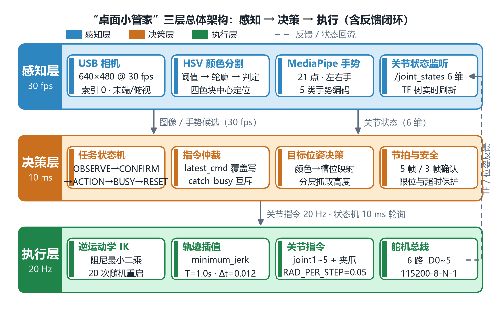
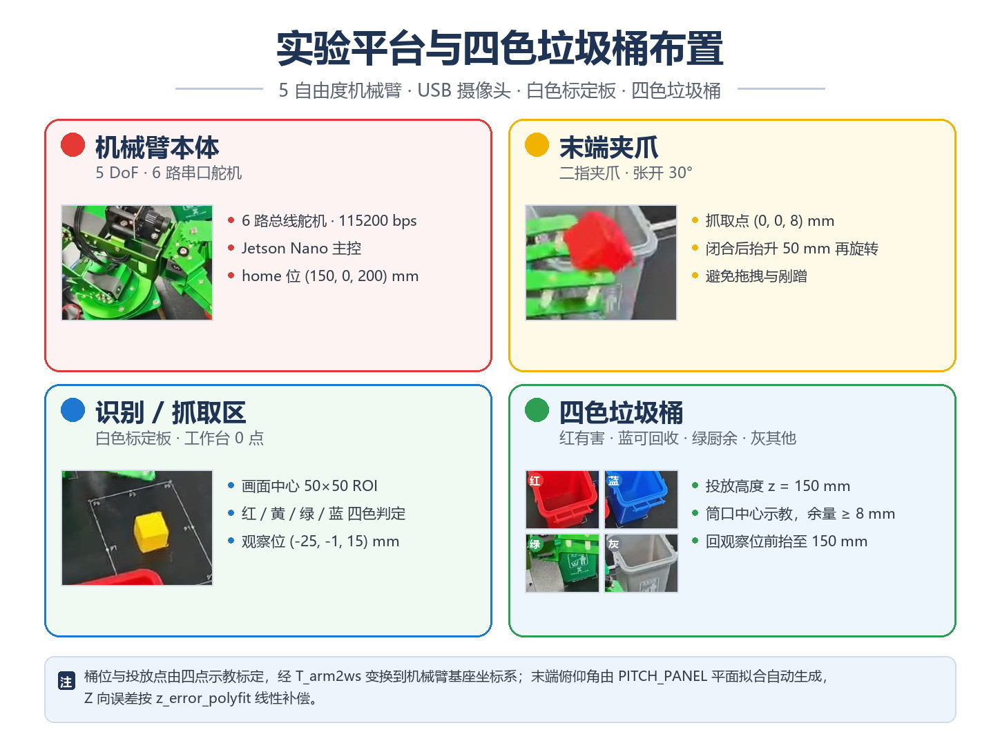

# 桌面小管家 · 5 自由度机械臂视觉分拣与手势搬运

一台 DICE 5 自由度串口舵机机械臂，配上 Jetson Nano 和一只 USB 摄像头，让它自己认颜色分拣积木，也能听手势指挥搬东西。课程《机器人感知与控制综合实践》期末综合实践（方向 2）的第 6 组作业。



## 它到底能干什么

- **建模与可视化**：13 连杆 12 关节的 URDF，RViz 里四个方向核对关节方向和父子关系，同一份模型丢进 Gazebo 也能站住。
- **点到点抓放**：位姿经数值逆解出五个关节角，Minimum Jerk 轨迹插值下发；抓取按"接近—抓取—抬升—转移—放置—退出"六段走，不擦桌面也不碰塔身。
- **颜色分拣**：HSV 四色阈值取中心 ROI，加权命中率超过门限才认，识别到就抓起来丢进对应颜色的桶。8 块乱序供料 8/8，没有重复抓取。
- **手势搬运**：MediaPipe 取 21 个手部关键点，握拳停、伸食指左右转、五指张开抓，连续 5 帧确认才认，抓取期间用互斥锁防重入。

实拍：



## 环境

主控是 Jetson Nano（Ubuntu 18.04），串口 `/dev/ttyTHS1`，115200-8-N-1；换到 PC 上调试改成 `COM6` 或 `/dev/ttyUSB0` 就行，其余代码不用动。

- ROS1（Melodic 或 Noetic）+ catkin，需要 `rviz`、`gazebo_ros`、`robot_state_publisher`、`joint_state_publisher_gui`
- Python 3.6+，依赖：`opencv-python`、`numpy`、`mediapipe`、`pyyaml`
- 机械臂：DICE 5DoF 串口舵机机械臂（6 路舵机，ID0~5）

```bash
pip install opencv-python numpy mediapipe pyyaml
```

## 编译

```bash
mkdir -p ~/arm_ws/src && cd ~/arm_ws/src
git clone https://github.com/zhang-hn-1/Robot-Final.git
cd ~/arm_ws && catkin_make && source devel/setup.bash
```

如果源码放在 exFAT 的 U 盘上，`catkin_make` 会因为不支持符号链接报错，复制到本地工作空间再编译即可。

## 跑起来

```bash
# 1) 只看模型：RViz + 关节滑块，不接硬件
roslaunch desktop_arm_description display.launch

# 2) 模型 + 算法节点（手势、颜色分拣的 ROS 薄封装）
roslaunch desktop_arm_description stack.launch

# 3) 物理仿真：同一份 URDF 注入 Gazebo，大臂预置静息位
roslaunch desktop_arm_description gazebo.launch
```

颜色分拣与手势这两条链路原本跑在 Jupyter 里，直接开 notebook 更接近我们当时调试的状态：

```bash
# 手势端（笔记本 + 摄像头）：先改 new.py 顶部的 ARM_HOST / ARM_PORT
python src/gesture/new.py

# 颜色分拣：config.py 里改串口名，SDK 需要能 import
export PYTHONPATH=$PWD/src/arm_sdk:$PYTHONPATH
jupyter notebook src/color_sort/我的垃圾分类.ipynb
```

跑之前确认三件事：串口名对不对、相机是不是索引 0、手势端和服务端 IP 通不通（默认 `192.168.55.1:9999`）。

## 目录

```text
Robot-Final/
├─ urdf/          arm5dof.urdf（13 连杆 / 12 关节）+ meshes/ 14 个 STL + check_urdf.py 离线校验
├─ launch/        display / stack / gazebo 三层启动
├─ rviz/          workcell.rviz
├─ src/
│   ├─ arm_sdk/      串口 SDK 封装：位姿、逆解、Minimum Jerk、误差补偿
│   ├─ gesture/      new.py 手势客户端 + 我的通讯识别.ipynb 指令服务端
│   ├─ color_sort/   我的垃圾分类.ipynb 颜色识别与分拣状态机
│   ├─ tracking/     摄像头目标追踪
│   └─ lab/          方块归位、抓取测试
├─ scripts/       color_sort_node.py、gesture_tcp_node.py（ROS 薄封装）
├─ config/        参数说明（标定文件需自己生成）
├─ docs/          综合设计报告 PDF、图源清单、README 用图
└─ 代码包自检.md   哪些是原始文件、哪些是按报告参数复原，MD5 对照表
```

## 几个关键参数

都在 `src/arm_sdk/config.py` 里，换一台机械臂大概只需要动这几处：

- `JOINT2SERVO_K` / `JOINT2SERVO_B`：舵机原始角度与关节弧度的线性标定，六个关节各一组
- `ARM_POSE_DICT`：home、拍摄位、物块释放位等预设点，格式 `[x, y, z, pitch, roll]`，单位 mm 与 rad
- `PITCH_PANEL_A/B/C`：工作台平面的俯仰角拟合系数，不指定 pitch 时自动生成
- `TRAJECTORY_DELTA_T = 0.012`、`RAD_PER_STEP = 0.05`：轨迹插值周期与步长
- 抓取常量在 `arm_test.py`：`GRAB_CUBE_DZ = 5 mm`、`LIFT_UP_DZ = 50 mm`、夹爪张开 30°

`z_error_polyfit.txt`、`T_arm2ws.txt`、`object.yaml` 三个标定产物没随仓库提供，需要按 `config/README_配置文件说明.md` 自己标一遍，否则末端会有几毫米到十几毫米的系统偏差。

## 已知限制

- 颜色识别用固定 HSV 阈值，换房间、换灯就得重标；自动曝光会把阈值工作点带跑。
- 单目相机没有深度，抓取点靠"相机固定 + 标定板 + 固定观察位"的映射保证，相机一挪就得重新标定。
- `scripts/` 下两个 ROS 节点只做过语法检查，没在真实 ROS 环境里逐帧回归，当示例看更合适。
- `minimum_jerk.py`、`transform.py` 是按 SDK 调用点和课程公式复原的，不保证与原实现逐位一致（原文件未随材料提供）。

## 组员分工

| 姓名 | 负责 |
|---|---|
| 张航宁（24061733） | URDF 建模与 RViz/Gazebo 验证、运动控制与 Pick & Place |
| 张浩轩（24061720） | 手势识别（MediaPipe 与手指判据）、TCP 通信与指令服务端 |
| 吴锐超（24061734） | HSV 颜色识别与自动分拣、状态机互锁与系统集成测试 |

## 参考与致谢

- 手势编码（四指状态位拼 0~15 码）借鉴了 [Gesture-Controlled-Virtual-Mouse](https://github.com/Viral-Doshi/Gesture-Controlled-Virtual-Mouse)，判据、双级确认、状态机与通信全部重写；`src/gesture/new.py` 属于该项目的派生文件，因此整体沿用 GPL-3.0。
- 手部关键点用 [MediaPipe Hands](https://google.github.io/mediapipe/solutions/hands.html)，图像处理用 [OpenCV](https://opencv.org)，机械臂 SDK 来自 [DICE](https://www.dice.com.cn/)，框架是 [ROS](https://www.ros.org)。

综合设计报告（57 页，正文 53 页，含建模、算法、实验数据与故障复盘）在 [docs/第6组_综合设计报告.pdf](docs/第6组_综合设计报告.pdf)。

课程代码：(2026-2027-1)-S0610350-04。License: GPL-3.0。
